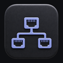
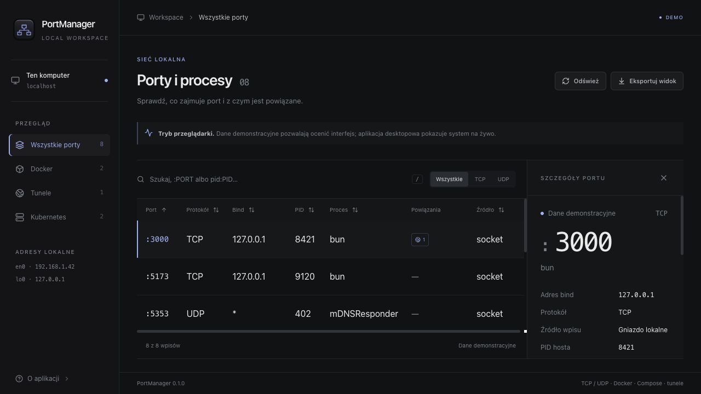
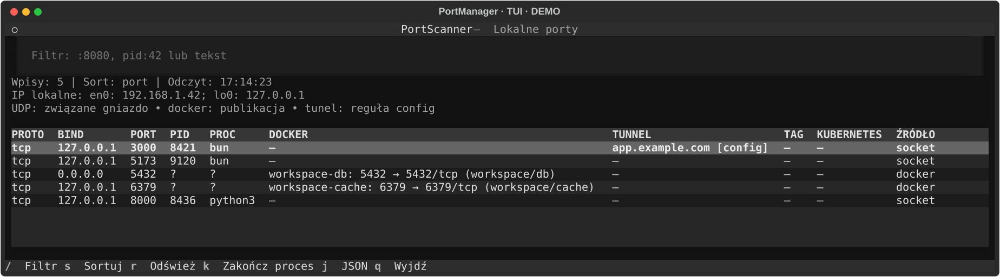

<p align="center">
  
</p>

<h1 align="center">PortManager</h1>

<p align="center">
  <strong>Zajęty port? Zobacz, co za nim stoi.</strong><br>
  Porty, procesy, kontenery i tunele — w jednym lokalnym workspace.
</p>

<p align="center">
  <a href="#szybki-start">Uruchom</a> ·
  <a href="#trzy-interfejsy-jeden-core">Zobacz tryby pracy</a> ·
  <a href="#pod-maską">Poznaj architekturę</a> ·
  <a href="#dokumentacja">Dokumentacja</a>
</p>

<p align="center">
  <a href="LICENSE"></a>
  
  <a href="docs/release.md"></a>
</p>

<h3 align="center">Technologie</h3>

<p align="center">
  
  
  
  
  
  
</p>

<p align="center">
  
  
  
  
  
</p>



<p align="center"><sub>Rzeczywisty interfejs Vue w podglądzie przeglądarkowym, z danymi demonstracyjnymi. Aplikacja desktopowa odczytuje dane systemu na żywo.</sub></p>

## Od numeru portu do odpowiedzi

Dev server nie startuje, bo `3000` jest już zajęty. Baza działa w Dockerze, ale nie pamiętasz mapowania. Tunel wskazuje usługę, którą trzeba odnaleźć. **PortManager łączy te informacje w jeden widok**, żeby skrócić drogę od „co tu działa?” do kolejnego kroku.

- **Znajdź właściciela portu.** Zobacz adres bind, protokół, PID, nazwę i dostępne argumenty procesu. Filtruj po `:8080`, `pid:8421` lub tekście.
- **Połącz lokalny serwis z jego otoczeniem.** Sprawdź publikacje Docker, projekt i usługę Compose oraz reguły tuneli cloudflared.
- **Dodaj kontekst Kubernetes.** Opcjonalnie zobacz NodePort węzłów o lokalnym IP i cele lokalnych sesji `kubectl port-forward`.
- **Zwolnij port świadomie.** Zakończ dozwolony własny proces po weryfikacji i potwierdzeniu. Procesy infrastruktury są chronione.
- **Zabierz wynik do swojego workflow.** Eksportuj widok do JSON albo użyj CLI w skrypcie.

PortManager odczytuje lokalne gniazda TCP/UDP; nie skanuje zdalnych hostów. Kubernetes jest opcjonalnym odczytem API klastra, a sprawdzenie publicznego exit IP wymaga osobnej, jawnej akcji.

## Trzy interfejsy, jeden core

| Tryb | Kiedy go wybrać | Co dostajesz |
| :--- | :--- | :--- |
| **GUI** · `portscanner --gui` | Chcesz obejrzeć środowisko i zajrzeć w szczegóły portu. | Inspektor, filtry źródeł, sortowanie, odświeżanie i natywny eksport JSON. |
| **TUI** · `portscanner` | Pracujesz w terminalu i chcesz zostać przy klawiaturze. | Interaktywna tabela, odświeżanie co 2 s, filtr, eksport i dialog operacji. |
| **CLI** · `portscanner --cli` | Potrzebujesz jednego odczytu lub danych do automatyzacji. | Czytelna tabela albo JSON na stdout, raporty źródeł na stderr i kody wyjścia. |

### Terminal też ma swój workspace



*Widok działającego Textual wyeksportowany w trybie testowym z danymi demonstracyjnymi.*

`/` filtruj · `s` sortuj · `r` odśwież · `j` eksportuj JSON · `k` otwórz dialog zakończenia procesu · `q` wyjdź

### Małe polecenia, konkretne odpowiedzi

Po instalacji w aktywnym środowisku używaj `portscanner`; przy pracy z repozytorium poprzedź polecenia przez `uv run --locked`.

```bash
# Co zajmuje port 8080?
portscanner --cli --filter :8080

# Przekaż wynik do jq lub własnego skryptu
portscanner --cli --json | jq '.[] | select(.port == 8080)'

# Dodaj kontekst Kubernetes
portscanner --cli --kube

# Zweryfikuj proces i otwórz pytanie o zgodę na zakończenie
portscanner --cli --kill 8421
```

PID w przykładzie jest demonstracyjny — podaj PID własnego procesu. Operacja kończy cały proces, wraz ze wszystkimi jego portami. [Reguły i allowlista →](docs/cli.md#kończenie-procesu)

## Szybki start

**Wymagania:** Python **3.12+** i [uv](https://docs.astral.sh/uv/). Do zbudowania GUI dodatkowo **Bun 1.4.3**, zgodnie z `frontend/package.json`, i **Node** do kontroli typów Vue. CLI i TUI nie wymagają Bun ani środowiska graficznego.

```bash
git clone https://github.com/MrDeex1k/PortManager.git
cd PortManager
uv sync --locked

uv run --locked portscanner          # TUI
uv run --locked portscanner --cli    # jednorazowa tabela
uv run --locked portscanner --help   # dostępne opcje
```

**Chcesz okno desktopowe?** Zainstaluj dodatek GUI i zbuduj frontend:

```bash
uv sync --locked --extra gui
cd frontend
bun install --frozen-lockfile
bun run build
cd ..
uv run --locked --extra gui portscanner --gui
```

Zweryfikowana platforma: **macOS ARM64**. Instalacja odbywa się ze źródeł lub lokalnego wheel; [zakres zgodności i uprawnienia](docs/release.md#platformy-i-uprawnienia).

Dla Kubernetes dodaj `--kube` do wybranego trybu; w GUI możesz też użyć przełącznika. Instrukcje instalacji przez pipx i tworzenia skrótu `PortManager.app`: [instalacja](docs/release.md) · [GUI](docs/gui.md).

> **Widoczność zależy od uprawnień systemu.** Na macOS pełny odczyt gniazd może wymagać root; aplikacja nie podnosi uprawnień automatycznie. Po odmowie na macOS pokazuje gniazda dostępnych procesów z raportem `partial`. Sprawdzaj raporty źródeł — pusta tabela przy błędzie odczytu nie oznacza wolnych portów. CLI sygnalizuje błąd podstawowego odczytu kodem `1`, także przy częściowym JSON.

<details>
<summary><strong>Chcę tylko obejrzeć GUI, bez odczytu systemu</strong></summary>

W katalogu `frontend` wykonaj:

```bash
bun install --frozen-lockfile
bun run dev
```

Otwórz adres wypisany przez Vite. Przeglądarka pokazuje wbudowane dane demo; odczyt systemu i operacje na procesach wymagają aplikacji desktopowej.

</details>

## Pod maską

**Jedna logika domenowa. Trzy sposoby pracy.** Niezależny od UI pakiet `portscanner/core/` zbiera wspólną migawkę, wzbogaca dane i egzekwuje reguły operacji. CLI, TUI i mostek desktopowy korzystają z tego samego kontraktu.

```text
System · Docker · cloudflared · Kubernetes (opcjonalnie)
                         │
                 portscanner/core
              migawki · filtry · operacje
                         │
          ┌──────────────┼──────────────┐
        CLI             TUI            GUI
    Typer + Rich      Textual     pywebview + Vue
```

- **Odporność na częściowe dane.** Awaria opcjonalnego źródła nie usuwa pozostałych wyników; każdy odczyt ma jawny status.
- **Responsywność podczas odczytu.** TUI i GUI zbierają dane w tle. Kubernetes ma cache, odświeżanie co 30 s i zachowanie poprzednich mapowań po błędzie z raportem wieku danych.
- **Kontrola operacji na procesach.** Właściciel, allowlista i tożsamość procesu są sprawdzane ponownie po zgodzie, przed wysłaniem sygnału. Znane flagi uwierzytelniające są maskowane w prezentowanych argumentach.
- **Testy na kilku poziomach.** Kontrakty JSON, interakcje Textual Pilot, mostek GUI i integracje z gniazdami loopback oraz tymczasowym procesem testowym.

| Warstwa | Narzędzia i rola |
| :--- | :--- |
| Odczyt i modele | Python, psutil, PyYAML, niemutowalne dataclasses |
| Terminal | Typer, Rich, Textual |
| Desktop | pywebview, Vue 3, TypeScript, TanStack Query / Table, Tailwind CSS 4, Lucide |
| Budowanie i jakość | uv, Hatchling, Bun, Vite, pytest, Ruff, Pyrefly, vue-tsc, Prettier, Lefthook |
| Integracje | Lokalny Docker / Compose, cloudflared, opcjonalnie Kubernetes przez kubectl |

<details>
<summary><strong>Rozwój i kontrole lokalne</strong></summary>

Z katalogu głównego repozytorium:

```bash
uv run --locked ruff check .
uv run --locked ruff format --check .
uv run --locked pyrefly check
uv run --locked pytest
uv run --locked python scripts/build_release.py
```

Po instalacji zależności frontendu, w katalogu `frontend`:

```bash
bun run test
bun run format:check
bun run build
```

`build` sprawdza też typy przez vue-tsc. Środowisko, zakres testów i hooki: [rozwój i testy](docs/development.md).
Wydanie z GUI zbuduj przez `scripts/build_release.py --gui` z katalogu głównego;
[pakowanie i weryfikacja artefaktów](docs/release.md) opisują oba warianty.

</details>

## Interpretacja wyników

<details>
<summary><strong>Jak interpretować wyniki</strong></summary>

- TCP oznacza gniazdo w stanie LISTEN; UDP — związane gniazdo bez widocznego zdalnego adresu, bez potwierdzenia odpowiedzi serwera. Na Windows peer UDP jest nieznany, więc lista może zawierać także klientów.
- Publikacja Docker i konfiguracja NodePort nie potwierdzają istnienia gniazda hosta ani dostępności usługi.
- Reguła tunelu nie potwierdza publicznej dostępności hostname; tagi K8s są heurystyką.
- Argumenty procesów mogą być niepełne. Maskowanie obejmuje znane flagi, nie dowolne sekrety w treści argumentów.
- Exit IP jest pobierane wyłącznie jawnie przez HTTPS do ipify i ujawnia tej usłudze adres wyjściowy użytej trasy.

Pełny kontrakt i ograniczenia: [API core](docs/core-api.md) · [Kubernetes](docs/kubernetes.md).

</details>

## Dokumentacja

| Chcę… | Otwórz |
| :--- | :--- |
| Poznać flagi, JSON i reguły kończenia procesów | [CLI](docs/cli.md) |
| Opanować klawiaturę i eksport | [TUI](docs/tui.md) |
| Uruchomić desktop lub utworzyć skrót macOS | [GUI](docs/gui.md) |
| Powiązać lokalne porty z klastrem | [Kubernetes](docs/kubernetes.md) |
| Użyć core z Pythona | [API core](docs/core-api.md) |
| Zbudować i zainstalować lokalny wheel | [Instalacja i pakowanie](docs/release.md) |
| Poznać decyzje techniczne | [Architektura](docs/architecture.md) |
| Rozwijać projekt i uruchamiać kontrole | [Rozwój i testy](docs/development.md) · [Conventional Commits](docs/conventional-commits.md) |
| Przejrzeć całą dokumentację i historię zmian | [Dokumentacja](docs/README.md) · [Changelog](CHANGELOG.md) |

---

**Sprawdź, co działa na Twoim komputerze.** [Uruchom PortManager](#szybki-start), a pomysły i odtwarzalne błędy zgłoś w [Issues](https://github.com/MrDeex1k/PortManager/issues).
